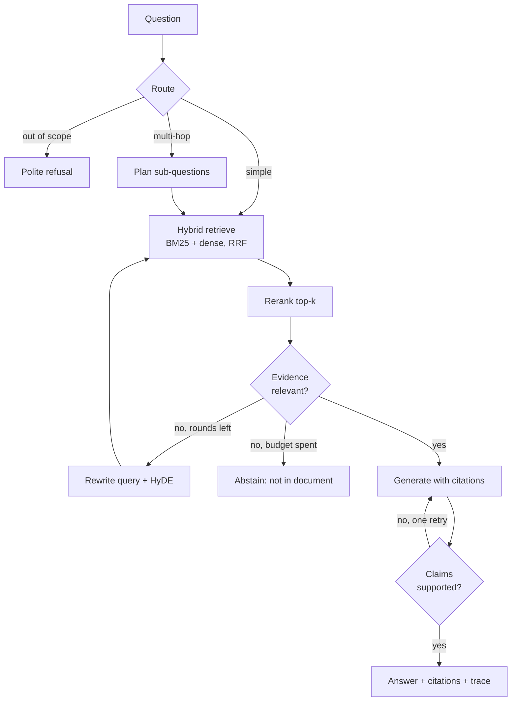

# ragdoc · Agentic RAG over documents

[](https://github.com/abhisinghh/RAG_over_doc/actions/workflows/ci.yml)
[](https://colab.research.google.com/github/abhisinghh/RAG_over_doc/blob/main/notebooks/demo.ipynb)

Question answering over your PDFs, Word and Markdown files that **cites the page behind every
claim, says "not in the document" instead of guessing, and shows its work**. It combines
contextual hybrid retrieval with a bounded, self-correcting agent loop, and ships with an
evaluation harness that compares the dense baseline, hybrid retrieval and the agentic loop on
your own golden set.

## Highlights

| Stage | What it does | Based on |
| --- | --- | --- |
| Parsing | Docling layout parsing (tables as Markdown, reading order, page numbers); pypdf fallback; .docx/.md/.txt | — |
| Chunking | Structure-aware, token-sized chunks that never cross sections; tables kept whole | — |
| Contextual retrieval | An LLM writes a short context header per chunk before embedding and BM25 indexing (prompt-cached) | [Anthropic, 2024](https://www.anthropic.com/news/contextual-retrieval) |
| Summary tree | Optional RAPTOR-style summaries for whole-document questions | [RAPTOR](https://arxiv.org/abs/2401.18059) |
| Hybrid search | BM25 + dense vectors fused with Reciprocal Rank Fusion | Cormack et al., 2009 |
| Reranking | LLM listwise, local cross-encoder (bge-reranker) or Cohere | — |
| Routing | Simple / multi-hop / out-of-scope, so easy questions stay cheap | [Adaptive-RAG](https://arxiv.org/abs/2403.14403) |
| Planning | Multi-hop questions split into self-contained sub-questions | [IRCoT](https://arxiv.org/abs/2212.10509) |
| Evidence grading | 0-3 relevance per passage; weak evidence triggers a rewrite + HyDE retry, then abstention | [CRAG](https://arxiv.org/abs/2401.15884), [HyDE](https://arxiv.org/abs/2212.10496) |
| Cited generation | Every sentence cites `[n]` → file + page; invalid markers stripped | — |
| Verification | Claims checked against sources; unsupported claims trigger one revision | [Self-RAG](https://arxiv.org/abs/2310.11511), [CoVe](https://arxiv.org/abs/2309.11495) |
| Guardrails | Retrieved text treated as data, injection screening, optional PII redaction | — |
| Observability | Per-step latency + tokens in every answer; OpenTelemetry export (Phoenix, Langfuse) | — |
| Interfaces | CLI, REST API with streaming, Gradio UI, MCP server, Python API | — |

## How it works



Ingestion is a one-off per document and idempotent by file hash:
`parse → (redact) → chunk → contextualize → (summary tree) → embed → index`.

Set `agent.enabled: false` and the same index answers in a single pass, which is the
baseline the evaluation compares against.

## Quickstart

```bash
git clone https://github.com/abhisinghh/RAG_over_doc.git && cd RAG_over_doc
python -m venv .venv && source .venv/bin/activate
pip install -e ".[api,ui]"            # add ,docling for layout-aware PDF parsing
cp .env.example .env                  # add OPENAI_API_KEY (or ANTHROPIC_API_KEY)

ragdoc ingest path/to/report.pdf      # or a whole folder
ragdoc ask "What were the main risks identified in 2024?" --trace
```

Example output (illustrative):

```text
Operating margin rose from 14% to 17% [1], mainly from lower logistics costs [2].

Sources
  [1] report.pdf, page(s) 15: Operating margin for the year was 17%, up from 14%...
  [2] report.pdf, page(s) 22: Logistics costs fell 8% following the consolidation...

route=simple · 4210 ms · 9120+412 tokens
```

Other entry points:

```bash
ragdoc batch questions.txt -f report.pdf --output output.json   # the original notebook workflow
ragdoc ui                                                       # Gradio app with live agent steps
ragdoc serve                                                    # REST API on :8000
ragdoc mcp                                                      # MCP server for Claude Desktop / IDE agents
ragdoc docs | ragdoc delete <doc_id>
```

Python:

```python
from ragdoc.engine import RagEngine

engine = RagEngine.from_config()          # configs/default.yaml + .env
engine.ingest("report.pdf")
result = engine.ask("How did margins change and why?")
print(result.answer)
for c in result.citations:
    print(c.marker, c.source, c.pages)
```

## Configuration

All settings live in [`configs/default.yaml`](configs/default.yaml); secrets only in `.env`.
Override any value with an overlay file (`-o configs/experiments/dense.yaml`) or an
environment variable `RAGDOC__<SECTION>__<KEY>`:

```bash
RAGDOC__LLM__PROVIDER=anthropic \
RAGDOC__LLM__FAST_MODEL=claude-haiku-5-5 \
RAGDOC__LLM__STRONG_MODEL=claude-sonnet-5-5 \
ragdoc ask "..."
```

| Want | Setting |
| --- | --- |
| Local models via Ollama / vLLM | `llm.provider: openai_compatible`, `llm.base_url: http://localhost:11434/v1`; `embeddings.provider: local` |
| Cheaper ingestion | `ingestion.contextualize: false` |
| Whole-document / summary questions | `ingestion.raptor: true` |
| Best reranking quality offline | `pip install ".[local]"`, `retrieval.reranker: cross_encoder` |
| Production vector DB | `retrieval.qdrant_url: http://qdrant:6333` (see `docker/`) |
| Tracing | `tracing.otlp_endpoint: http://localhost:6006/v1/traces` (Phoenix) |

Models are configurable per role: a small `fast_model` routes, grades, rewrites and
contextualizes; the `strong_model` writes the answer.

## Evaluation

Retrieval quality, faithfulness, correctness, abstention, latency and cost, side by side:

```bash
cp eval/datasets/golden.example.jsonl eval/datasets/golden.jsonl   # then write your own questions
mkdir -p eval/datasets/docs && cp report.pdf eval/datasets/docs/
python eval/run_eval.py              # dense vs hybrid vs agentic → eval/reports/<timestamp>/report.md
```

| Layer | Metrics |
| --- | --- |
| Retrieval | hit@k, page recall@k, MRR, nDCG@k against gold pages |
| Generation | faithfulness (share of claims supported, LLM judge), correctness vs reference (LLM judge), citation page precision |
| Agent | abstention accuracy on unanswerable questions, LLM calls per answer |
| System | p50 / p95 latency, tokens per answer |

Aim for 50-100 questions over 2-3 representative documents, mixing single-fact, table,
multi-hop, summary and ~10-15% unanswerable questions.

## API

| Method | Path | Purpose |
| --- | --- | --- |
| GET | `/health` | Liveness and index stats |
| GET / POST | `/documents` | List / upload and ingest (multipart) |
| DELETE | `/documents/{doc_id}` | Remove a document |
| POST | `/search` | Hybrid search + rerank, no generation |
| POST | `/ask` | Cited answer; `"debug": true` adds the trace |
| POST | `/ask/stream` | Server-Sent Events: one `step` per agent node, then `result` |

`docker compose -f docker/docker-compose.yml up --build` starts the API, a Qdrant server and
Arize Phoenix for traces (http://localhost:6006).

## Project layout

```
src/ragdoc/
├── config.py            typed settings: YAML + env overrides, secrets from .env
├── engine.py            RagEngine facade used by every interface
├── ingestion/           parsers, chunking, contextual retrieval, summary tree, pipeline
├── models/              provider-agnostic LLM (structured output) and cached embeddings
├── retrieval/           Qdrant / in-memory vectors, BM25, RRF, rerankers, query transforms
├── agent/               LangGraph state, nodes and graph; tools for MCP
├── generation/          numbered sources in, [n] citations out
├── guardrails/          prompt-injection screen, PII redaction
├── observability/       per-step trace + OpenTelemetry export
├── evaluation/          metrics, LLM judges, multi-config runner
├── prompts/             versioned prompt templates (.md)
├── api/ ui/ mcp_server.py cli.py
configs/                 default.yaml + experiments/{dense,hybrid,agentic}.yaml
eval/                    golden dataset template and run_eval.py
tests/                   offline suite with a scripted LLM and hashing embedder
docs/                    architecture and decision records
```

## Development

```bash
pip install -e ".[dev,api]"
make test        # offline: scripted LLM + hashing embedder, no API keys needed
make lint
```

## Roadmap

- [x] Contextual hybrid retrieval, reranking, citations, evaluation harness
- [x] Agentic loop: routing, planning, grading, rewrite + HyDE, verification, abstention
- [x] API with streaming, Gradio UI, MCP server, caching, guardrails, Docker, tracing
- [ ] GraphRAG / LightRAG mode for global and multi-hop questions
- [ ] Multimodal: figure captions, ColPali page-image retrieval
- [ ] pgvector backend
- [ ] Published benchmark results for dense vs graph vs agentic

## References

- Lewis et al., [Retrieval-Augmented Generation for Knowledge-Intensive NLP Tasks](https://arxiv.org/abs/2005.11401), 2020
- Singh et al., [Agentic Retrieval-Augmented Generation: A Survey on Agentic RAG](https://arxiv.org/abs/2501.09136), 2025
- Anthropic, [Introducing Contextual Retrieval](https://www.anthropic.com/news/contextual-retrieval), 2024
- Jeong et al., [Adaptive-RAG](https://arxiv.org/abs/2403.14403), 2024 · Yan et al., [Corrective RAG](https://arxiv.org/abs/2401.15884), 2024 · Asai et al., [Self-RAG](https://arxiv.org/abs/2310.11511), 2023
- Gao et al., [HyDE](https://arxiv.org/abs/2212.10496), 2022 · Dhuliawala et al., [Chain-of-Verification](https://arxiv.org/abs/2309.11495), 2023
- Sarthi et al., [RAPTOR](https://arxiv.org/abs/2401.18059), 2024 · Liu et al., [Lost in the Middle](https://arxiv.org/abs/2307.03172), 2023
- Es et al., [RAGAS](https://arxiv.org/abs/2309.15217), 2023
- Mendelevitch & Bao, [Hands-On RAG for Production](https://www.oreilly.com/library/view/hands-on-rag-for/9798341621701/), O'Reilly 2026 ([code](https://github.com/ofermend/hands-on-rag))
