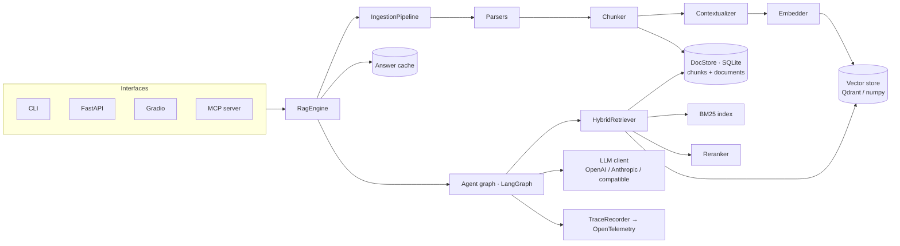

# Architecture

How tables, charts, images, audio, video, code, microservices, GraphRAG and scale are handled
is described in [design/multimodal-graph-scale.md](design/multimodal-graph-scale.md). This page
covers the core components and the agent loop.

## Components

* **SQLite is the source of truth** for chunk text and metadata; the vector store only holds
  vectors keyed by chunk id. Swapping Qdrant for pgvector means implementing the three-method
  `VectorStore` protocol in `retrieval/store.py`.
* **BM25 is rebuilt in memory** from the chunk store whenever the corpus changes. This is fast
  up to roughly 100k chunks; beyond that, move to Qdrant sparse vectors or OpenSearch.
* **The engine is the only public surface.** CLI, API, UI, MCP and evals all call
  `RagEngine`, so behaviour is identical everywhere and tests cover one code path.

## Agent loop

Nodes live in `agent/nodes.py`; wiring in `agent/graph.py`. Each node opens a trace span, so
every answer carries per-step latency and token usage.

| Node | Model | Output | Failure behaviour |
| --- | --- | --- | --- |
| route | fast | one of the routes the index can serve (simple, multi_hop, global, relational, structured, code) or out_of_scope | defaults to simple |
| plan | fast | ≤ `max_sub_questions` sub-questions | falls back to the original question |
| retrieve | — | route strategy (graph facts, community reports, SQL result, call/service graph) + hybrid top-k, merged | a failing strategy falls back to hybrid only |
| grade | fast | 0-3 relevance per passage (graph facts and SQL results are pinned) | fails open (all relevant) |
| rewrite | fast | new query + HyDE passage | reuses the question |
| generate | strong / vision | answer with `[n]` citations; top figures attached for vision models | abstains if no evidence |
| verify | fast | per-claim support | accepts unverified, flags it |
| abstain | — | fixed "not in the document" answer | — |

Budgets: `agent.max_rewrites` retrieval retries, `agent.max_revisions` answer revisions and
a LangGraph recursion limit of 50, so a question costs a bounded number of model calls
(simple path: 5-6 calls with LLM reranking).

## Failure taxonomy

Following *Hands-On RAG for Production* (ch. 6), problems are attributed to a layer:

| Layer | Symptom | Where to look |
| --- | --- | --- |
| Ingestion | text missing or garbled, tables flattened | `parse` span, `ragdoc docs`, try `ingestion.parser: docling` |
| Retrieval | right page not in candidates | eval hit@k / recall@k, `retrieve` span ids |
| Ranking | right page retrieved but dropped | compare `/search` before and after reranking |
| Generation | unsupported or uncited claims | `verify` span, eval faithfulness |
| Agent | needless rewrites or abstentions | `grade` span scores, eval abstention accuracy |

## Security notes

* Retrieved text is wrapped in `<source>` / `<passage>` tags, escaped, and every prompt
  instructs the model to treat it as data. Passages matching injection heuristics are demoted.
* API keys are read only from the environment / `.env`, never from YAML.
* The API has no authentication; put it behind a gateway or add a dependency in
  `api/app.py` before exposing it.
* Embedded Qdrant (local path) allows one process per index folder. Run the API and the CLI
  against a Qdrant server (`retrieval.qdrant_url`) if both need the index at once.
