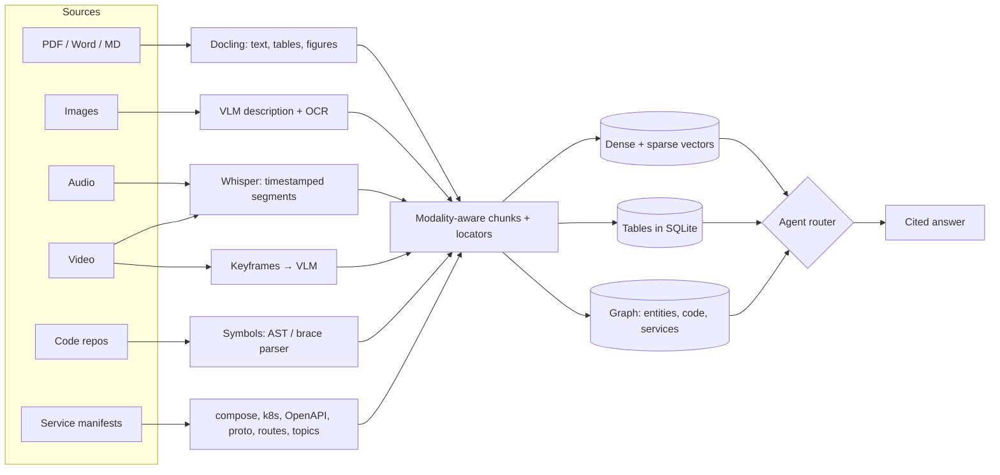
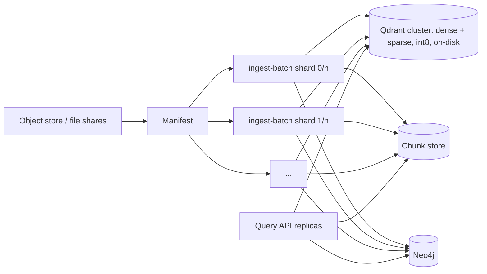

# Design: multimodal content, GraphRAG, code, microservices and scale

Every source becomes the same thing: a **chunk with a modality and a locator** (page, figure,
`mm:ss` range, `file:lines`). Retrieval, grading, generation, citation and evaluation then
work identically for a PDF paragraph, a chart, a podcast minute or a Go function. What differs
per modality is how content is *extracted* and which *retrieval strategy* the agent picks.

## Tables

Tables fail in naive RAG in three ways: they are flattened into word soup, split mid-row,
and arithmetic over them is done by the language model, which is unreliable.

| Problem | What ragdoc does | Where |
| --- | --- | --- |
| Lost structure | Docling exports tables as Markdown; pypdf/docx/md tables are tagged `modality: table` | `ingestion/parsers.py` |
| Split across pages | Consecutive-page tables with the same header (or same width) are stitched | `tables.merge_multipage_tables` |
| Too big for one chunk | Row-group chunks (`tables.rows_per_chunk`) with the header repeated in each | `chunking._split_table` |
| Missing context | Contextual header (section, caption, what the table measures) before embedding | `contextualize.py` |
| Numeric questions | Every table is loaded into SQLite with typed columns (currency, %, k/m/b, parentheses negatives parsed). The `structured` route plans a read-only SELECT over the relevant tables and cites the result | `tables.TableStore`, `answer_with_sql` |
| Safety | Single statement, SELECT/WITH only, SQLite authorizer denies writes, PRAGMA and ATTACH | `TableStore.run_sql` |

## Charts and figures

| Step | Detail |
| --- | --- |
| Extraction | Docling renders picture regions (vector charts included); pypdf extracts embedded raster images as a fallback; standalone images and video keyframes enter the same path |
| Filtering | Duplicates (logos) removed by hash; images below `multimodal.min_image_px` dropped; the VLM marks decorative images `informative: false` and they are discarded |
| Understanding | A vision model writes title, description, legible text (OCR) and, for charts, the **data as a Markdown table**, labelled approximate |
| Indexing | The description is an `image`/`chart` chunk citing its page and linking the stored PNG (`/assets/...`). Chart data also goes into the SQL table store, flagged approximate |
| Image search | Optional CLIP vectors (`multimodal.image_embeddings`) let text queries find figures even when the description misses the wording |
| Answering | The top cited figures are attached to the generator when it is a vision model, so it can read the chart itself, not only its description; the UI shows them in a gallery |

For slide decks or scanned documents where layout *is* the content, the next step is
page-image retrieval with a late-interaction vision retriever (ColPali family); the asset
store and `image` modality are the integration points.

## Audio

* ffmpeg normalises to 16 kHz mono and cuts ~10-minute pieces (API size limits).
* Whisper (`whisper-1`, segment timestamps) or local faster-whisper transcribes; offsets are
  re-applied per piece.
* Segments are grouped into windows of `media.window_seconds` (default 90 s), so a chunk is a
  coherent stretch of speech with a `start_s`/`end_s`. Citations read `12:40-14:10`.
* Speaker diarisation (pyannote) can fill `Segment.speaker`; the chunker already carries it.

## Video

* Soundtrack → the audio path above.
* Keyframes every `media.keyframe_interval_s` seconds, or on scene changes
  (`media.keyframe_scene_threshold`), capped at `max_keyframes`.
* Each frame is described by the VLM **with the transcript around that moment as context**,
  so "the slide shown when they discuss churn" is findable. Frames are cited as
  `frame at 03:30` and shown in the UI.

## Code repositories (thousands of files, long files)

| Concern | Approach |
| --- | --- |
| Chunk boundaries | One chunk per function/method; classes become an *outline* chunk (signature, fields, member signatures) so bodies are never indexed twice; module-level code gets its own chunks |
| Long functions | Overlapping line windows (`code.symbol_max_lines`, `window_overlap_lines`) |
| Languages | Python via `ast`; JS/TS, Go, Java, Kotlin, C#, Rust, C/C++, Scala, Swift, PHP via declaration patterns + brace matching on comment/string-stripped source; everything else in line windows |
| Context | Deterministic header (language, symbol, path, service, docstring, calls) instead of an LLM call, so 10k files cost embeddings only |
| Navigation | Code graph: `file —DEFINES→ symbol`, `symbol —CALLS→ symbol` (resolved same file > same service > unique name), `file —IMPORTS→ module`. The `code` route answers "who calls X / what does X call" with the real code chunks |
| Updates | Code document ids are per path, so an edited file replaces its old chunks; unchanged files are skipped but still parsed for the graph |
| Noise | `node_modules`, `vendor`, build output, lock files, minified and binary files are skipped |

## Hundreds of microservices

The service map is built from the repositories alone, without a running system:

| Signal | Source |
| --- | --- |
| Services | docker-compose services, Kubernetes Deployments/StatefulSets, directories with a Dockerfile or build manifest |
| Endpoints | OpenAPI/Swagger specs; FastAPI, Flask, Express, Spring, Gin/net-http, ASP.NET route declarations; gRPC `rpc` definitions |
| Sync calls | URLs and `*_URL`/`*_HOST` env vars naming another service; compose `depends_on`; generated gRPC clients matched to the `.proto` owner |
| Async flows | Topics/queues published and consumed (Kafka, RabbitMQ, SNS/SQS, NATS patterns) |
| Datastores | Database/cache/broker images and connection-string schemes |

Every edge keeps `file:line` evidence. Each service gets a summary chunk (endpoints, calls,
callers, topics, datastores, an LLM-written responsibility line), plus paged system
overviews. Questions like "what breaks if payments is down?" use the graph: direct callers,
consumers of its topics, and transitive dependants up to three hops.

## GraphRAG

| Layer | Implementation |
| --- | --- |
| Extraction | One fast-model call per prose/table/transcript chunk extracts typed entities and relations with descriptions and strengths |
| Resolution | Names normalised (case, articles, punctuation); entities share one namespace across types; descriptions and sources merge on upsert |
| Storage | SQLite (zero services) or Neo4j (`graph.store: neo4j`) behind one interface; every node/edge keeps the chunk ids it came from, so graph answers cite text |
| Communities | Louvain on the entity graph; oversized communities split again (level 1); an LLM report per community, indexed as `community` chunks. For very large graphs run Leiden in Neo4j GDS and load the result |
| Local search (`relational` route) | Entities matched by name and by vector → their relations (1-2 hops) → a facts chunk + the most-mentioned source chunks |
| Global search (`global` route) | Community reports ranked against the question |
| Incremental | Extraction runs per document at ingest; `ragdoc graph build` recomputes communities when convenient |

## Millions of documents

| Bottleneck | Mitigation in ragdoc | Next step beyond |
| --- | --- | --- |
| Ingestion throughput | `ingest-batch`: parallel workers, job table (resume, retry with cap), `--shard i/n` for many machines, content-hash skip | A queue (SQS/Kafka) feeding the same worker code; Batch API embeddings at half price |
| Lexical search in RAM | `retrieval.lexical: qdrant_sparse`: BM25 sparse vectors in Qdrant, dense + sparse fused server-side with RRF in one call | — |
| Vector memory | `retrieval.quantization: int8`, `retrieval.on_disk: true`, payload indexes on `doc_id`, `kind`, `modality` | Sharding and replication in the Qdrant cluster |
| Recall across a huge corpus | `retrieval.doc_routing`: search one summary vector per document first, then only those documents' chunks | Tenant/collection partitioning by business unit |
| Cost per document | Contextual headers and graph extraction on the fast model; code needs no LLM; per-modality switches | Contextualise only high-value collections |
| Chunk store | SQLite with indexes (single node) | Move `DocStore` to Postgres for multi-replica APIs (one class, same interface) |
| Graph size | Neo4j backend; communities computed offline | Neo4j GDS Leiden, periodic |
| Answer cost | Router keeps simple questions on the cheap path; answer cache keyed on corpus fingerprint | Semantic cache |

## What is deliberately not done

* No speaker diarisation, OCR-only scanned PDFs, or slide-level ColPali retrieval yet; the
  data model has the fields and modalities for them.
* The microservice map is static analysis. It finds what the code and manifests declare;
  runtime-only calls (service mesh routing, dynamic URLs) need traces (OpenTelemetry service
  graphs) merged into the same graph store.
